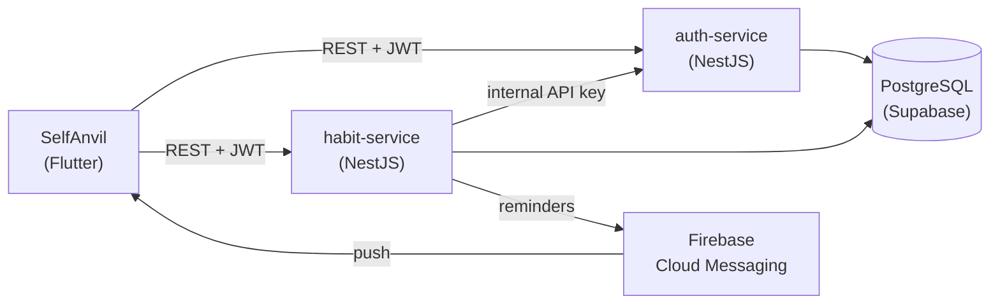

# SelfAnvil

A daily tasks and habits app with subtasks and push reminders, built with Flutter. Completing a task "forges" it: a flame rendered by a custom fragment shader sweeps across the card.

This repository is the mobile client. It talks to two backend services that I also built and deployed:

| Repository | What it is |
|---|---|
| **Auto-Admin-App** (this one) | Flutter client for Android |
| [auth-service](https://github.com/MoiBeta/auth-service) | NestJS service for accounts and JWT sessions |
| [habit-service](https://github.com/MoiBeta/habit-service) | NestJS service for habits, subtasks and reminders |

## Features

- **Accounts:** register, log in and log out, with sessions that renew themselves in the background.
- **Tasks and habits:** daily, weekly, monthly and yearly habits, plus one-time tasks that stay visible until they are done.
- **Subtasks:** each task has a checklist, and each day keeps its own progress.
- **Reminders:** push notifications at the time the user chose, in their own time zone.
- **Day navigation:** browse what was due on any day.
- **Undo on delete:** a deleted task can be restored before the deletion is sent to the server.
- **Light and dark themes** that follow the system setting.

## Architecture



Both services run as Docker containers on an AWS Lightsail instance, behind a Caddy reverse proxy that serves them over HTTPS. The database is a managed PostgreSQL on Supabase.

### Inside the app

The code follows a feature-first Clean Architecture. Each feature is split into three layers, and dependencies only point inwards:

```
lib/
├── core/                 # Networking, token storage, error types, time zone
├── features/
│   ├── auth/
│   │   ├── data/         # Remote data sources, models, repository implementations
│   │   ├── domain/       # Entities, repository contracts, use cases
│   │   └── presentation/ # Pages, widgets, Riverpod providers
│   ├── tasks/            # Same three layers
│   └── notifications/    # FCM setup and device token registration
└── global/               # Router, theme, shared widgets, the forge animation
```

## Tech stack

| Area | Choice |
|---|---|
| State management and DI | Riverpod 3 with code generation |
| Navigation | go_router |
| HTTP | Dio with interceptors |
| Token storage | flutter_secure_storage |
| Push notifications | Firebase Cloud Messaging |
| Animations | Fragment shader (GLSL) and Lottie |
| CI/CD | Codemagic and Firebase App Distribution |

## Implementation details worth a look

- **Single-flight token refresh** ([auth_interceptor.dart](lib/core/network/interceptors/auth_interceptor.dart)). The backend rotates refresh tokens, so two refreshes in parallel would invalidate each other. When several requests fail with 401 at once, they all wait for the same refresh and are then retried with the new token.
- **Sessions survive bad networks.** Only a refresh token rejected by the server ends the session. A network error keeps the tokens, so the user is not logged out for being offline.
- **Typed errors** ([error_interceptor.dart](lib/core/network/interceptors/error_interceptor.dart)). Every HTTP and network failure is mapped to one error type with a message ready to show to the user.
- **The forge animation** ([shaders/forge_fire.frag](shaders/forge_fire.frag)). The flame is procedural noise in a GLSL fragment shader, driven from Flutter by time, progress and intensity uniforms.

## Getting started

Requirements: Flutter 3.47.3 and a running copy of both backend services.

```bash
cp .env.example .env          # then set the two backend URLs
flutter pub get
dart run build_runner build --delete-conflicting-outputs
flutter run
```

The Firebase configuration in this repository points to my own Firebase project. To receive push notifications in your own build, create a Firebase project and run `flutterfire configure`.

## Tests

```bash
flutter analyze
flutter test
```

The suite has 174 unit and widget tests. They cover the network interceptors, the task list state (including undo and failed saves), the screens, the theme and the forge animation.

## CI/CD

[codemagic.yaml](codemagic.yaml) defines the pipeline. Every push to `master` runs code generation, static analysis and the tests, builds a release APK and publishes it to testers through Firebase App Distribution.

## Roadmap

- Sign release builds with a dedicated keystore and publish to Google Play.
- iOS build.
